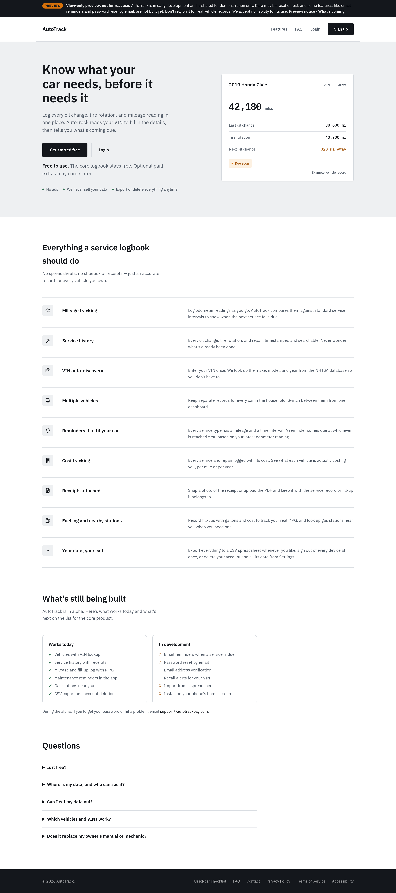
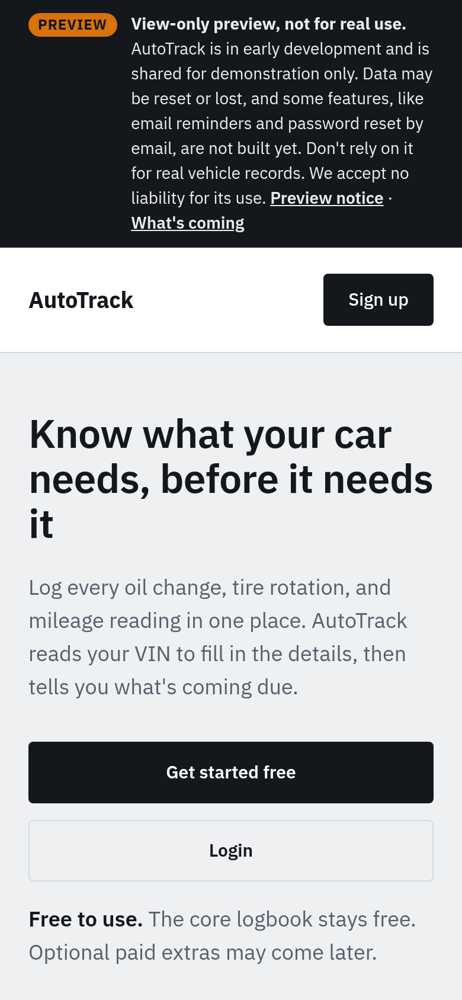
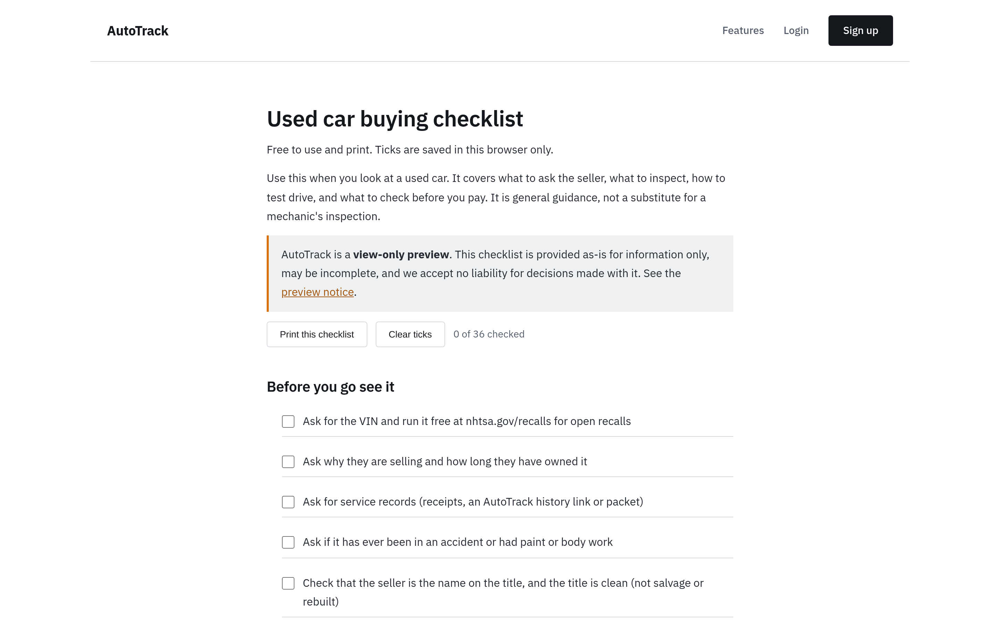
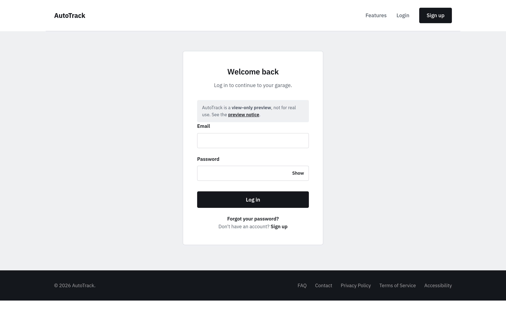
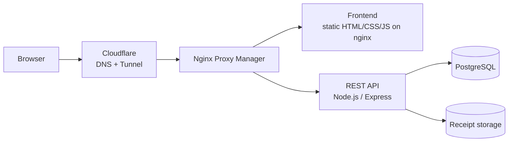

# AutoTrack

**A web app for keeping a car's service history: log maintenance, mileage and costs, get told what's coming
due, and hand a clean service record to the next owner.** I built it end to end, from database to deployment, and
self-host it behind Cloudflare.

> This is a **showcase only**: screenshots and a high-level overview. The source code is private.
> The live site is a view-only preview.

  
  

## What it does
- **Garage:** add vehicles by **VIN** (details filled in automatically from the VIN)
- **Maintenance log:** oil changes, tires, repairs, with receipt uploads
- **Mileage tracking** and **cost reports** per vehicle
- **Reminders:** what's due next, by date or mileage
- **Shop visit sheet:** print it when you drop the car off. It lists what is actually due by your own records, so you can check any extra work a shop suggests
- **Share & sell:** a read-only history link and a printable **sale packet** for buyers
- **Used-car buying checklist:** free, printable, ticks saved locally
- **Import from a spreadsheet**, export of your own data, guided onboarding

  
  

## How it's built

| Layer | Tech |
|---|---|
| Frontend | Plain HTML/CSS/JS (no framework, no build step), responsive, light design system with WCAG contrast rules |
| API | Node.js, Express, JWT access + refresh tokens, Multer uploads |
| Data | PostgreSQL 15, with its own least-privilege application role |
| Hosting | Docker containers on my Proxmox homelab, Nginx Proxy Manager, **Cloudflare Tunnel** (the server is never directly exposed to the internet) |

## Security & privacy
- `helmet` security headers, rate limiting on auth, input validation, parameter-pollution protection, bcrypt password hashing
- The app's database role can only touch its own tables (not a superuser)
- Every deploy is a tagged container image with a **one-command rollback**; nginx changes are tested in a throwaway container before going live
- **Backups:** nightly database dumps and app backups, mirrored across two hosts, kept 14 days. **Restores tested.**
- Privacy by design: self-hosted fonts (no Google requests), web access logging off, short log retention
- A published privacy policy, terms of service, accessibility statement and third-party notices

## What I learned
- Shipping a full product, not just a feature: auth, uploads, data export, legal pages, onboarding.
- Safe deployment without a CI service: image tagging, health checks, rollback, cache-busting.
- Running a public app from home securely behind a tunnel instead of opening ports.
- Writing for real users: plain language, accessibility, mobile-first layouts.

---
*Part of my homelab portfolio. See also [homelab](https://github.com/proxy9108/homelab).*
